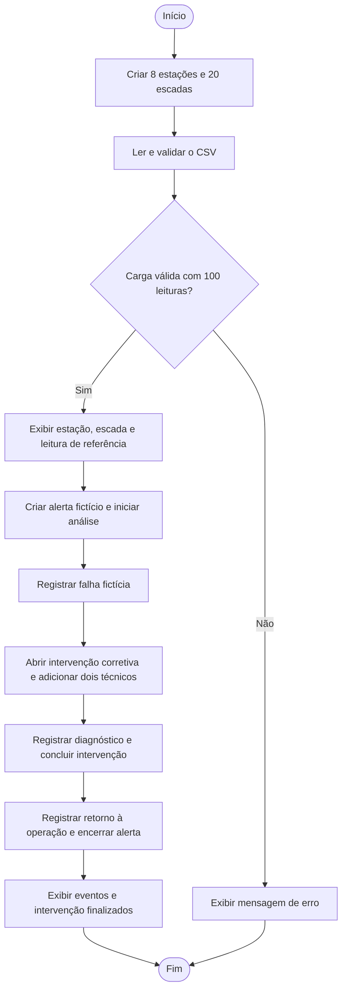

# Escala

Projeto acadêmico desenvolvido para o desafio da Motiva, na disciplina de Domain Driven Design com Java. A proposta é organizar informações de escadas rolantes, leituras de sensores e ocorrências de manutenção para apoiar o acompanhamento dos equipamentos.

Esta versão é uma aplicação de console que carrega **100 leituras simuladas**, distribuídas entre **20 escadas rolantes de 8 estações**, e demonstra o registro de um alerta, uma falha e uma intervenção com participação de técnicos.

## Integrantes

| Nome | RM |
| --- | --- |
| Gabriel Ardito | 568318 |
| Giovanna Oliveira | 566643 |
| João Gonzales | 568166 |
| Maria Druzeic | 566634 |
| Marianne Mukai | 568001 |

## Funcionalidades

- Cadastro simulado de estações e escadas rolantes, compartilhando os objetos de estação entre os equipamentos associados.
- Importação de leituras de sensores de um arquivo CSV, vinculando cada leitura à escada cadastrada.
- Validação de dados obrigatórios, valores numéricos e períodos de leitura.
- Acompanhamento de alertas nos estados `ABERTO`, `EM_ANALISE` e `ENCERRADO`.
- Registro de falhas, diagnósticos e retorno à operação.
- Registro de intervenções, técnicos participantes, ação realizada e resultado.
- Demonstração integrada no `Main` e testes de comportamento em drivers separados.

## Modelo de domínio

| Classe | Responsabilidade e relacionamentos |
| --- | --- |
| `Estacao` | Identifica a estação pelo ID, nome e local. Pode estar associada a várias escadas. |
| `EscadaRolante` | Representa um equipamento, sua estação, setor, criticidade e características nominais. |
| `LeituraSensor` | Guarda as medições de uma escada em um período e seu estado operacional. |
| `PeriodoLeitura` | Objeto de valor que representa início e fim de um intervalo válido. |
| `Evento` | Classe abstrata com os dados comuns de ocorrências: ID, escada, data de registro e descrição. |
| `Alerta` | Especialização de `Evento` com prioridade, evidência, regra aplicada e controle de estado. |
| `Falha` | Especialização de `Evento` com início da ocorrência, diagnóstico e retorno à operação. |
| `Tecnico` | Identifica um participante de uma intervenção pelo ID e nome. |
| `Intervencao` | Registra um serviço em uma escada, com evento de origem opcional, tipo, participantes e conclusão. |

Uma intervenção pode ter vários técnicos. Quando existe um evento de origem, ele deve pertencer à mesma escada da intervenção. A classe `Intervencao` possui uma associação com `Evento` e não faz parte de sua hierarquia de herança.

### Conceitos aplicados

- **Encapsulamento:** atributos privados e métodos que validam alterações e transições de estado.
- **Herança e polimorfismo:** `Alerta` e `Falha` estendem `Evento`; uma `List<Evento>` permite apresentar ambos utilizando suas implementações de `toString()`.
- **Objeto de valor:** `PeriodoLeitura` é imutável, valida a ordem das datas e implementa `equals()` e `hashCode()` com base em seus valores.
- **Enums:** `Criticidade`, `EstadoOperacional`, `PrioridadeAlerta`, `StatusAlerta` e `TipoIntervencao` representam conjuntos definidos de opções.
- **Exceções:** `DadosInvalidos` representa dados recusados pelas validações. `IllegalStateException` sinaliza operações incompatíveis com o estado atual do objeto.
- **Coleções:** listas organizam escadas, leituras, eventos e técnicos; os participantes de uma intervenção são disponibilizados por uma cópia não modificável da lista.

## Dados simulados

O arquivo [dados/leituras.csv](dados/leituras.csv) contém **100 registros de dados, além do cabeçalho**, com **5 leituras por escada**. O cadastro dos equipamentos é criado por `CadastroSimulado`.

As 19 colunas do CSV incluem identificação da leitura e da escada, início e fim do intervalo, estado operacional, temperaturas, vibrações, nível e pressão de óleo, tensão, corrente, potência, energia e velocidades.

O leitor utiliza um formato específico:

- Codificação UTF-8 sem BOM e separador `;`.
- Cabeçalho com os nomes e a ordem presentes no arquivo fornecido.
- Ponto como separador decimal.
- Datas e horários no formato ISO, como `2026-08-03T17:00:00`.
- Identificadores de escadas correspondentes aos equipamentos cadastrados.

O campo de pressão de óleo pode estar vazio. A corrente de pico e a duração da partida existem no modelo Java, mas não constam neste CSV; por isso, são carregadas como `null` e exibidas como “Sem registro de partida”.

**Os dados são sintéticos.** O alerta, a falha e a intervenção apresentados no `Main` são criados manualmente para demonstrar as regras do domínio. Eles não são resultados de uma análise automática das 100 leituras nem representam ocorrências reais da empresa.

## Organização do projeto

| Caminho | Conteúdo |
| --- | --- |
| `src/Main.java` | Demonstração integrada da aplicação. |
| `src/modelo/` | Classes de domínio, objeto de valor e enums. |
| `src/excecao/` | Exceção personalizada `DadosInvalidos`. |
| `src/simulacao/` | Cadastro simulado e leitor do CSV. |
| `src/teste/` | Drivers executáveis para verificar comportamentos. |
| `dados/leituras.csv` | Recorte de 100 leituras simuladas. |
| `README.md` | Apresentação, instruções e fluxograma. |

## Como executar no IntelliJ IDEA

O projeto utiliza apenas a biblioteca padrão do Java, sem dependências externas ou configuração de Maven/Gradle. O código utiliza recursos disponíveis a partir do **Java 11**. A configuração original do IntelliJ aponta para o **JDK 26**; caso essa versão não esteja instalada, selecione um JDK compatível nas configurações do projeto.

1. Clone ou baixe o repositório e abra a pasta do projeto no IntelliJ IDEA.
2. Confira o JDK em **File → Project Structure → Project SDK**.
3. Verifique se a pasta `src` está reconhecida como pasta de código-fonte. Se necessário, clique nela com o botão direito e selecione **Mark Directory as → Sources Root**.
4. Abra `src/Main.java` e execute o método `main` pelo botão de execução ao lado dele.
5. Confira os resultados no console.

O diretório de trabalho da execução deve ser a **raiz do projeto**, que contém as pastas `src` e `dados`. O programa procura o arquivo pelo caminho relativo `dados/leituras.csv`. Se o arquivo não for encontrado, confira esse diretório na configuração de execução do IntelliJ e a localização do CSV.

### Resultado esperado

O console começa com:

```text
ESCALA - DEMONSTRAÇÃO COM DADOS SIMULADOS
Escadas cadastradas: 20
Leituras carregadas: 100
```

Em seguida, apresenta a estação e a escada da primeira leitura, suas medições e o cenário fictício de manutenção. Ao final, o alerta está `ENCERRADO`, a falha possui diagnóstico e retorno à operação, e a intervenção está concluída com dois técnicos, ação realizada e resultado registrados.

## Fluxograma da demonstração

O diagrama representa o fluxo executado pelo `Main`. A criação dos eventos de manutenção é uma etapa programada da demonstração.



Erros de leitura do arquivo são tratados por `IOException`. Dados inválidos e operações recusadas pelas regras do domínio também interrompem a demonstração com uma mensagem no console. A conclusão da intervenção, o retorno à operação e o encerramento do alerta são chamadas explícitas no `Main`.

## Drivers de teste

Cada classe abaixo possui seu próprio método `main` e pode ser executada separadamente no IntelliJ.

| Driver em `src/teste/` | Verificação principal |
| --- | --- |
| `EstacaoDriver` | Cadastro, alterações e rejeição de campos obrigatórios inválidos. |
| `EscadaRolanteDriver` | Associação com estação, alterações e validação dos dados do equipamento. |
| `PeriodoLeituraDriver` | Validade do período, igualdade por valor e consistência de hashes. |
| `LeituraSensorDriver` | Criação da leitura e rejeição de temperatura não finita e dados obrigatórios inválidos. |
| `EventoDriver` | Uso de alertas e falhas por meio do tipo `Evento`. |
| `AlertaDriver` | Campos obrigatórios e transições permitidas e recusadas. |
| `FalhaDriver` | Datas, diagnóstico e registro único do retorno à operação. |
| `TecnicoDriver` | Cadastro e validação de ID e nome. |
| `IntervencaoDriver` | Participantes, conclusão, operações recusadas e associação com o evento de origem. |
| `CadastroSimuladoDriver` | Cadastro das 20 escadas e compartilhamento da estação entre equipamentos. |
| `LeituraCsvDriver` | Importação das 100 leituras e contagem de 5 registros por escada. |

Os drivers realizam verificações pelo console. Nos testes de rejeição, mensagens como `Passou` indicam que a exceção esperada foi capturada. Os resultados também devem ser conferidos pelos valores e estados exibidos.

Na verificação desta versão, o código foi compilado com compatibilidade para Java 11 e o `Main` e os 11 drivers foram executados no Java 17, sem falhas sinalizadas nas saídas.

## Escopo desta versão

A aplicação mantém os objetos em memória durante a execução. O CSV fornece as leituras, enquanto os eventos e a manutenção demonstram o funcionamento das classes e suas regras. Persistência em banco de dados, interface gráfica, geração automática de alertas e modelos preditivos não estão implementados nesta versão.
