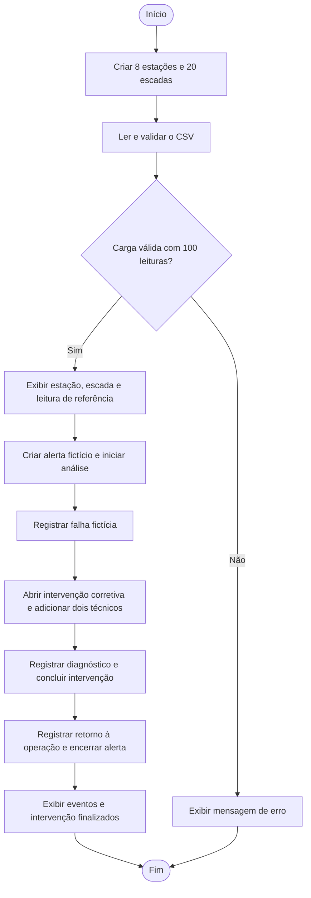

# Eskala — Fluxograma da demonstração

Este documento descreve o fluxo da aplicação de console executada por `src/Main.java`.

O programa cria o cadastro simulado e carrega as 100 leituras do CSV. Em seguida, executa um cenário fictício de manutenção, criado manualmente para demonstrar o comportamento das classes.

## Fluxo principal

Erros de leitura do arquivo são tratados por `IOException`. Dados inválidos e operações recusadas pelas regras do domínio também interrompem a demonstração com uma mensagem no console. A conclusão da intervenção, o retorno à operação e o encerramento do alerta são chamadas explícitas no `Main`.

## Regras demonstradas

- O cadastro contém 8 estações e 20 escadas rolantes.
- O `Main` exige exatamente 100 leituras importadas para continuar.
- A primeira leitura fornece a escada e a referência de horário usadas na demonstração.
- O alerta segue a sequência `ABERTO → EM_ANALISE → ENCERRADO`.
- A falha registra o início da ocorrência, o diagnóstico e o retorno à operação.
- A intervenção corretiva se associa à falha da mesma escada e recebe dois técnicos.
- A conclusão da intervenção exige pelo menos um técnico, término posterior ao início, ação realizada e resultado preenchidos.
- Alertas e falhas são exibidos por meio de uma lista do tipo `Evento`, demonstrando polimorfismo.

## Como interpretar

As caixas representam ações, o losango representa uma decisão e as setas indicam a ordem de execução. A decisão sobre a carga resume a leitura, as validações e a conferência da quantidade de registros; se ocorrer uma exceção durante a importação, o programa vai diretamente ao tratamento de erro.

O fluxo de manutenção representa o cenário escolhido no `Main`, não uma obrigação de que todo alerta gere uma falha. Os eventos não são deduzidos automaticamente das medições do CSV. A ligação explícita registrada na intervenção é com a falha; o alerta é encerrado por uma chamada separada no `Main`.

[Voltar ao README](../README.md)
